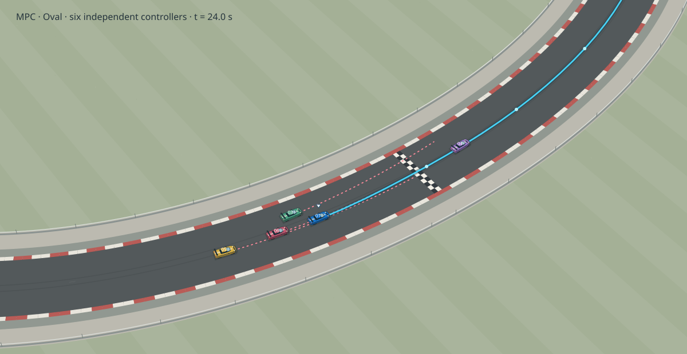

# vehicle_gym — multi-agent model predictive racing

Six independent nonlinear MPC controllers compete on an oval and packaged racing circuits. Every controller observes the same measured race state, predicts its five opponents, solves a new optimal control problem, and applies only the first input. The simulation then advances all cars together by 0.2 s.

[Interactive races](https://rudolfreiter.github.io/vehicle_gym/) · [ECC 2023 paper](https://publications.syscop.de/Reiter2023.pdf) · [HILEPP comparison](https://github.com/RudolfReiter/hilepp)



The research interface presents 240-second oval races and IMS/Sepang runs with 180-second limits. Select any car to inspect its current MPC horizon and its own assumptions about the other five vehicles. Race order, measured speed, numerical diagnostics and all published outcomes accompany the replay. Playback interpolates measured states and never loops automatically.

There is no RL policy or scripted blocking scenario in this experiment. Different vehicle limits, target speeds and lateral references produce the competition. The separate HILEPP repository compares HILEPP-II, direct SAC and pure MPC against the same five MPC opponents.

## Different vehicle capabilities

Each car has a `VehicleLimits` envelope, independently applied to its MPC:

| Car | Speed min/max (m/s) | Longitudinal min/max (m/s²) | Lateral min/max (m/s²) |
|---|---|---|---|
| 01 | 0 / 32 | −8 / 5 | −9 / 9 |
| 02 | 0 / 25 | −5 / 2.8 | −5.5 / 5.5 |
| 03 | 2 / 29 | −6.5 / 4 | −7 / 7.5 |
| 04 | 0 / 30 | −9 / 3.5 | −8 / 8 |
| 05 | 4 / 36 | −10 / 6 | −11 / 10.5 |
| 06 | 2 / 34 | −7.5 / 5.5 | −9.5 / 10 |

These are controller bounds, separate from target speed and lateral reference. Longitudinal acceleration includes aerodynamic and rolling resistance and is constrained at every control node, including the first. Speed and lateral acceleration remain soft constraints. Positive minimum speeds can relax when yielding. The full-braking obstacle assumption uses each follower’s own deceleration capability.

```python
from dataclasses import replace
from vehiclegym import CircuitRace, VehicleLimits

limits = [VehicleLimits() for _ in range(6)]
limits[1] = replace(limits[1], speed_max=25, longitudinal_max=3,
                    lateral_min=-6, lateral_max=6)
world = CircuitRace("Oval", duration=240, limits=limits)
```

The **Oval** is an explicitly synthetic ellipse with semi-axes 125 m and 80 m, about 650 m per lap. Its four-minute races permit repeated encounters and lap traffic. Geometry is periodic at every dynamics integration stage; unwrapped progress retains race order over arbitrarily many laps. A pass is registered after vehicle-length clearance, including passes across lap boundaries. The browser shows laps, gaps in laps/metres, a fixed start/finish line, and the exact limits of the selected recording.

## Run the experiment

Python 3.9+, a C compiler, CMake and a pinned acados installation are required for the new racing backend. The original portable IPOPT examples remain available.

```bash
python -m venv .venv
source .venv/bin/activate
pip install -e '.[dev,visualization]'
bash scripts/setup_acados.sh
# Export the ACADOS_SOURCE_DIR and LD_LIBRARY_PATH printed by the script.
export OPENBLAS_NUM_THREADS=1 OMP_NUM_THREADS=1
python -m vehiclegym.race_demo --tracks Oval IMS Sepang --duration 180 --oval-duration 240 \
  --seeds 30000 30001 30002 --output docs/data
python scripts/check_data.py
python scripts/build_report.py
python -m http.server 8000 --directory docs
```

Open http://localhost:8000. The included compressed replays work without Python, acados or a training framework when served by GitHub Pages. Opening `index.html` directly with a `file:` URL does not permit replay fetching in most browsers.

## Research implementation

- **Vehicle model:** original kinematic Frenet dynamics, states `[s, n, alpha, v, delta]`, controls longitudinal force and steering rate. Actual motion uses RK4 with four substeps per applied control.
- **Independent MPC:** six solver instances and warm starts, 25 shooting intervals over 5 s, acados SQP. Multiple initial guesses are tried when the first solve has excessive obstacle slack or numerical residual. Every candidate solves the same OCP; no heuristic actuator fallback is used.
- **Interaction model:** measured speed and heading error remain constant for leading/alongside cars in curvilinear coordinates. A car more than 4.6 m behind is assumed to brake at its own maximum deceleration until standstill. These are optimization assumptions, not forecasts of the other MPCs' intentions. The controller never reads their future plans.
- **Constraints:** soft state, lateral-acceleration and elliptical obstacle constraints; hard actuator and net longitudinal-acceleration bounds; approximate terminal heading and speed conditions. Slack and solver failures are recorded. This recreation does not establish recursive feasibility or reproduce the paper's quantitative results.
- **Circuits:** an analytic oval plus packaged IMS and Sepang coordinates, periodic arc-length parameterization and 6 m coordinate smoothing. Road constraints conservatively use the minimum packaged half-width; the renderer shows the same conservative usable width as the simulation. Surveyed widths remain in the exported track data.
- **Evaluation:** three fixed test seeds per circuit, matched starts across policies in HILEPP. A collision, track exit or rejected solve by any vehicle ends the entire race and remains in the published results. An opponent failure is identified by vehicle number.

See [control and prediction semantics](docs/CONTROL_AND_PREDICTION.md) and the [migration guide](docs/MIGRATION.md). Upstream examples, models and their [original documentation](docs/LEGACY.md) remain available.

## Source layout

| Module | Responsibility |
|---|---|
| `road/circuit.py` | Periodic packaged circuit geometry and nearest-lap opponent positions |
| `planner/race_mpc.py` | Independent acados OCP, constraints, warm starts and numerical acceptance |
| `planner/vehicle_limits.py` | Validated per-car speed and acceleration envelopes |
| `planner/opponent_prediction.py` | Measured-state opponent assumptions, integrated with RK4 |
| `simulator/circuit_race.py` | Synchronous six-car race and physical collision checks |
| `race_replay.py` | Recorded states, commands, all six plans and evaluation metrics |
| `docs/` | Static scientific viewer; current plans, race timing and telemetry |

## Verification

```bash
python -m pytest
bash scripts/check_style.sh
python scripts/check_data.py
node scripts/check_interactions.mjs
node scripts/render_scene.mjs
python scripts/build_site.py
```

Unit tests check shared-state replanning, direct-SAC bypass, HILEPP parameter isolation, circuit seams and opponent-mode changes. Data checks inspect every published controller frame. The JavaScript checks use DOM and Canvas doubles and do not substitute for browser layout testing. Numerical race generation requires acados; CI can validate committed replays without it.

## Citation

Rudolf Reiter, Jasper Hoffmann, Joschka Boedecker, and Moritz Diehl. **A Hierarchical Approach for Strategic Motion Planning in Autonomous Racing.** European Control Conference (ECC), 2023. [DOI: 10.23919/ECC57647.2023.10178143](https://doi.org/10.23919/ECC57647.2023.10178143).
